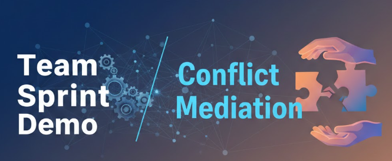

<p align="center">
  
</p>

<h1 align="center">Conflict Simulation</h1>

<p align="center">
  An interactive game where <strong>you are the mediator</strong> in a workplace conflict.
</p>

<p align="center">
  <strong>English</strong> · <a href="README_fr.md">Français</a> · <a href="README_pt-BR.md">Português</a>
</p>

<p align="center">
  
  
</p>

---

## Table of contents

- [About](#about)
- [Features](#features)
- [How to play](#how-to-play)
- [Getting started](#getting-started)
- [Project structure](#project-structure)
- [Creating your own scenario](#creating-your-own-scenario)
- [Contributing](#contributing)
- [License](#license)
- [Author](#author)

## About

**Conflict Simulation** is a small, browser-based role-play game built with [Streamlit](https://streamlit.io/). It puts you in the middle of a tense discussion between two teammates and asks you to calm things down — one message at a time.

The bundled scenario, **"Demo Deadline Conflict"**, takes place the day of a stakeholder demo:

- **Alex** promised a dashboard demo today and feels blindsided.
- **Sam** refuses to ship something broken after requirements changed three times.

Your job is to steer them toward a shared, realistic plan without taking sides. It is a light-weight way to practise mediation and communication skills: active listening, reframing, agreeing on scope, and setting clear working agreements.

## Features

- 🎭 **Branching mediation choices** — three possible responses per turn, each with a different impact.
- 📊 **Live meters** — watch tension and each person's trust in you change after every decision.
- 💬 **Chat-style transcript** — the whole conversation is shown with avatars for Alex, Sam and you.
- 🏁 **Win / lose conditions** — de-escalate the conflict, or watch it fall apart.
- 🔄 **Restart and finish controls** — replay to try different strategies.
- 🧩 **Data-driven scenario** — dialogue, scoring and rules live in one Python dictionary, so you can write your own scenario without touching the game logic.

## How to play

1. Read what Alex and Sam say in the current turn.
2. Pick one of the three mediation messages (**A**, **B** or **C**).
3. Your choice updates the meters and the next turn begins.

There are **8 turns** in total. Every choice is graded behind the scenes:

| Choice quality | Tension | Trust (Alex) | Trust (Sam) |
|----------------|:-------:|:------------:|:-----------:|
| Best           | −15     | +10          | +10         |
| Medium         | −5      | +3           | +3          |
| Bad            | +10     | −5           | −5          |

You start with **Tension 50** and **Trust 55** for each person. All values stay between 0 and 100.

The game is checked after every choice:

- ✅ **You win** when tension is **20 or lower** and trust with **both** Alex and Sam is **70 or higher**.
- ❌ **You lose** when tension reaches **85 or higher**, or trust with **either** person drops to **20 or lower**.
- If neither happens, the game ends after the last turn and shows your final stats.

> **Tip:** Good mediation responses tend to stay neutral, clarify what each person actually needs, and turn the discussion into concrete, shared agreements.

## Getting started

### Prerequisites

- [Python](https://www.python.org/downloads/) 3.9 or newer
- `pip`

### Installation

```bash
# 1. Clone the repository
git clone https://github.com/eduardodacostasoares/conflict_simulation.git
cd conflict_simulation

# 2. (Optional) Create and activate a virtual environment
python -m venv .venv
source .venv/bin/activate        # On Windows: .venv\Scripts\activate

# 3. Install the dependencies
pip install -r requirements.txt
```

### Run the app

```bash
streamlit run app.py
```

Streamlit will open the game in your browser, usually at <http://localhost:8501>.

> **Note:** Run the command from the project's root folder — the app loads its images from the `assets/` folder using relative paths.
>
> If you get an error mentioning `chat_message` or `use_container_width`, your Streamlit version is too old. Update it with `pip install --upgrade streamlit`.

## Project structure

```
conflict_simulation/
├── app.py              # Streamlit app: scenario data, game logic and UI
├── requirements.txt    # Python dependencies
└── assets/             # Images used by the app
    ├── header.png      # Banner shown at the top of the page
    ├── alex.png        # Alex's avatar
    ├── sam.png         # Sam's avatar
    ├── mediator.png    # Your (the mediator's) avatar
    └── good.png
```

## Creating your own scenario

All the content of the game is defined in the `SCENARIO` dictionary at the top of `app.py`:

| Key              | What it controls                                                        |
|------------------|-------------------------------------------------------------------------|
| `title`          | Page title shown in the browser and at the top of the app               |
| `initial_state`  | Starting values for tension and trust                                   |
| `scoring`        | How much each grade (`best`, `medium`, `bad`) changes the meters         |
| `end_conditions` | Thresholds for winning and losing                                       |
| `turns`          | The list of turns: what Alex and Sam say, and the three choices to pick |

Each turn follows this shape:

```python
{
    "alex": "What Alex says this turn.",
    "sam": "What Sam says this turn.",
    "choices": [
        {"id": "A", "text": "A mediation message.", "grade": "best"},
        {"id": "B", "text": "Another option.",      "grade": "medium"},
        {"id": "C", "text": "A poor option.",       "grade": "bad"},
    ],
},
```

Edit the dialogue, add or remove turns, or tune the scoring and thresholds to create a new challenge. To change the characters' pictures, replace the images in `assets/`.

## Contributing

Contributions, ideas and new scenarios are welcome!

1. Fork the repository.
2. Create a branch for your change: `git checkout -b my-new-scenario`
3. Commit your changes: `git commit -m "Add a new scenario"`
4. Push the branch: `git push origin my-new-scenario`
5. Open a pull request.

Found a bug or have a suggestion? Please [open an issue](https://github.com/eduardodacostasoares/conflict_simulation/issues).

## License

No license has been specified for this project yet. Until one is added, all rights are reserved by the author. Please contact the author before reusing the code.

## Author

**Eduardo da Costa Soares** — [@eduardodacostasoares](https://github.com/eduardodacostasoares)

If you enjoyed the project, consider giving it a ⭐ on GitHub!
